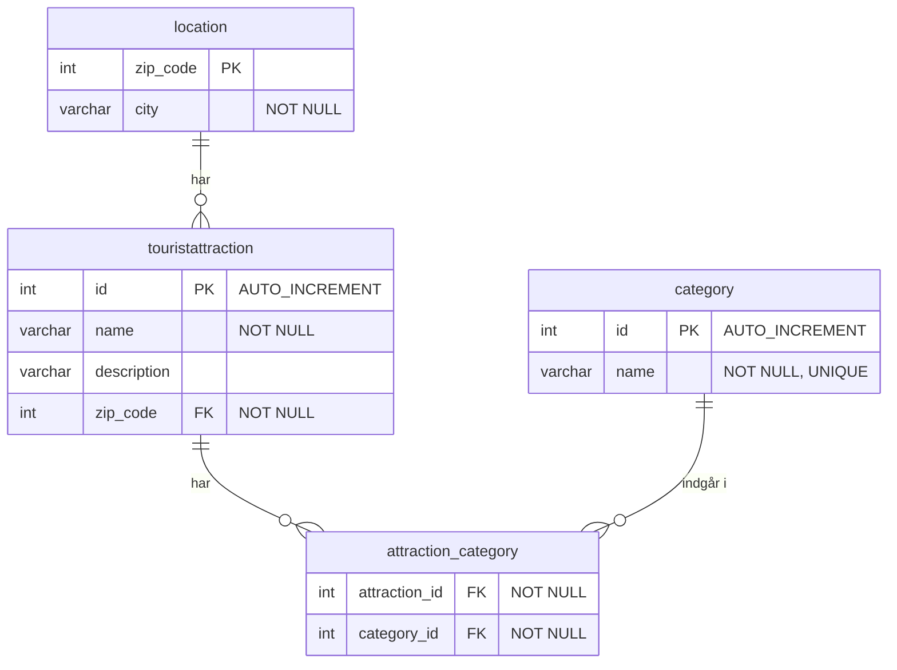

# Attractions Database

A MySQL database for tourist attractions. Each attraction belongs to a location (zip code and city) and can be tagged with one or more categories.

## ER Diagram



## Tables

| Table | Purpose |
|-------|---------|
| `location` | Zip codes and city names |
| `touristattraction` | The attractions, each linked to one location |
| `category` | Category names (unique) |
| `attraction_category` | Join table: an attraction can have many categories, and a category can have many attractions |

## Setup

```sql
DROP DATABASE IF EXISTS attractions_db;
CREATE DATABASE attractions_db;

USE attractions_db;

DROP TABLE IF EXISTS location;
DROP TABLE IF EXISTS touristattraction;
DROP TABLE IF EXISTS category;
DROP TABLE IF EXISTS attraction_category;

CREATE TABLE location (
    zip_code INT PRIMARY KEY,
    city VARCHAR(100) NOT NULL
);

CREATE TABLE touristattraction (
    id INT AUTO_INCREMENT PRIMARY KEY,
    name VARCHAR(100) NOT NULL,
    description VARCHAR(500),
    zip_code INT NOT NULL,
    FOREIGN KEY (zip_code) REFERENCES location (zip_code)
);

CREATE TABLE category (
    id INT AUTO_INCREMENT PRIMARY KEY,
    name VARCHAR(50) NOT NULL UNIQUE
);

CREATE TABLE attraction_category (
    attraction_id INT NOT NULL,
    category_id INT NOT NULL,
    FOREIGN KEY (attraction_id) REFERENCES touristattraction(id) ON DELETE CASCADE,
    FOREIGN KEY (category_id) REFERENCES category(id)
);
```
